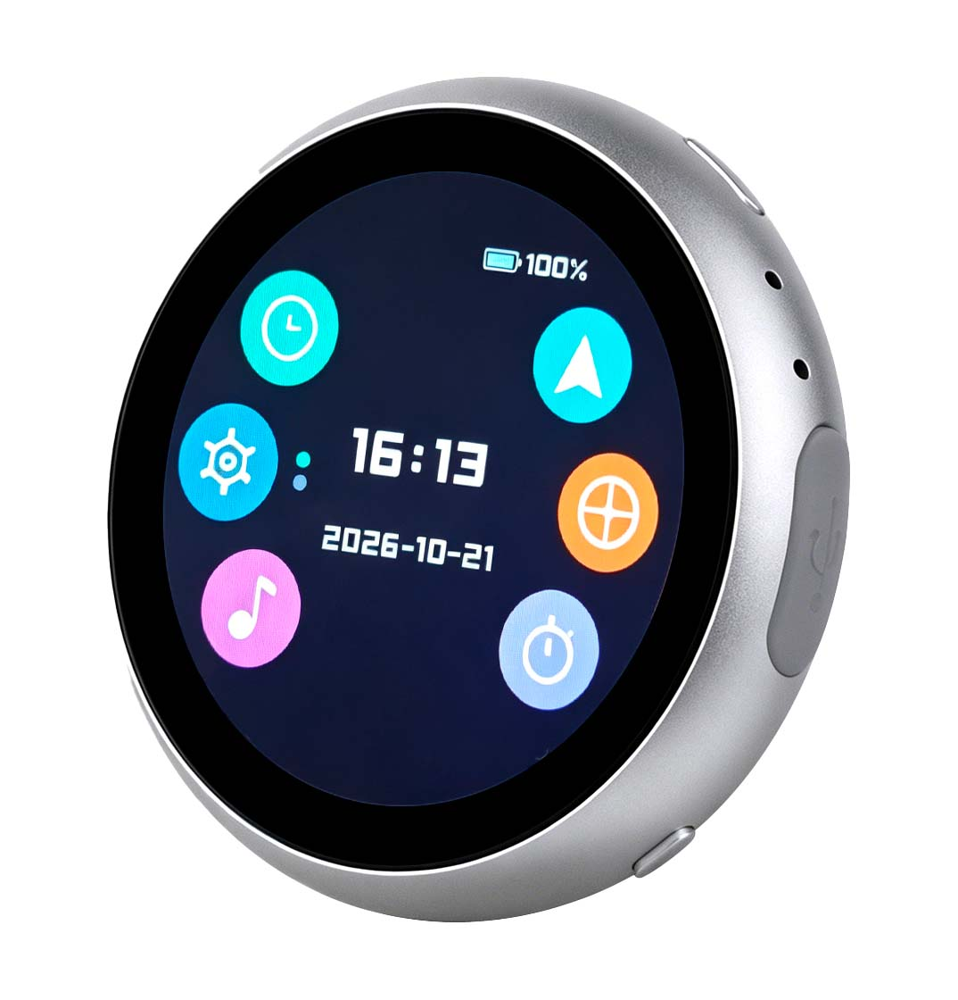

# ESP UI — 可扩展的 ESP32 设备 UI 系统



基于 [LVGL 9.3](https://lvgl.io/) 的可扩展设备 UI 框架，运行在 Waveshare **ESP32-S3-Touch-LCD-1.85B**（360×360 圆屏）上。内置一套手机式的 UI 骨架——桌面启动器、应用生命周期、多任务切换、手势导航、主题/字体/旋转系统——时钟、导航、音乐、G 力、计时器、设置等应用全部是**示例应用**，用于演示如何在这套系统上扩展你自己的功能。

- **每个应用的用法**见 [APPS.md](./APPS.md)（操作指南）。

**核心定位：发布的是 UI 框架本身，应用都是可替换的示例。**


## 功能特性

### UI 框架（可扩展的核心）
- **屏幕导航壳（`ui_shell`）**：桌面 / 应用 / 多任务三种界面，手机式应用生命周期——打开的应用保持打开、出现在多任务切换器中，支持逐个关闭和「全部清除」。
- **应用注册表（`ui_theme.c`）**：新增一个应用只需在 `ui_apps[]` 里登记一行（名称 / 图标 / 创建函数 / 内部返回钩子），shell 只通过钩子操作应用，**加应用不需要动导航壳**。
- **Android 风格手势（`gesture`）**：底部上滑回桌面、左右边缘内滑返回、桌面横向滑动翻页、上滑停顿进入多任务。
- **桌面启动器（`ui_desktop`）**：图标环分页布局（每页 6 个、上下滑动翻页），内置实时时钟 / 日期 / 电量图标 / WiFi 状态指示。
- **多任务切换器（`ui_multitask`）**：竖向卡片列表，卡片左侧 × 标签关闭应用。
- **主题系统（`ui_theme.h`）**：统一调色板（背景、文字、点缀色等），应用配色一改全改。
- **字体系统（`ui_fonts.h`）**：中文字体（MiSans）+ 大号数字字体（Hooge）+ 英文字体（Montserrat）分层注册。
- **屏幕自动旋转（`auto_rotate`）**：基于 QMI8658 姿态，0/90/180/270° 旋转屏幕内容，并同步变换触摸坐标；设置里可开关（默认关）。

### 示例应用
| 应用 | 说明 |
|---|---|
| 时钟 | 沉浸式表盘，长按切换表盘（可扩展多表盘，见 `clock_faces.c`） |
| 设置 | 瀑布卡片列表：自动旋转 / WiFi / 蓝牙 / 亮度 / 音量 / 电池 / 关于，亮度与音量滑块实时生效并持久化 |
| 音乐 | BLE 遥控播放 / 暂停 / 上一曲 / 下一曲，图标跟随手机真实状态 |
| 导航 | MotoNav 手机 App 通过 BLE 推送导航数据：无地图时大号转向箭头，有地图时 360×360 栅格地图渲染 |
| G 力 | 摩托车/自行车横向惯性力仪表，倾斜安装校准，水平投影消除安装倾角影响 |
| 计时 | 赛车风格秒表（MM:SS:CC、计圈、暂停/清零） |
| 其余 6 个 | 占位应用（地图 / 电话 / 相机 / 备忘录 / 日历…），演示分页效果，替换即可 |

### 驱动与服务层
- **ST77916** 360×360 QSPI 圆屏，上电读取寄存器自动检测面板版本（v1/v2），选择对应初始化序列。
- **CST816S** 电容触摸，与其余外设共享一条 I2C 总线。
- **QMI8658** 六轴 IMU（自动旋转数据源）。
- **PCF85063** RTC，断电保持时间，NTP 校时后写回。
- **BQ27220** 电量计，后台任务以 ≤2 次/秒轮询缓存，UI 任意线程可读（电压 / 百分比 / 充放电状态 / 电流）。
- **ES8311** 音频编解码 + I2S 输出，独立低优先级任务播放提示音，避免阻塞 LVGL 任务；音量 0–100 软件可调。
- **WiFi**（`wifi_mgr`）：无已存网络时自动开 SoftAP 配置页（`ESP_Setup_XXXX`），手机连热点填 WiFi 名密码，STA 自动重连，失败回退配置；联网后 NTP 自动校时。
- **BLE**（`nav_ble`）：NimBLE 外设，广播名 `MotoNav-XXXX`，Nordic UART Service 承载导航 / 音乐遥控文本协议。

## 硬件要求

| 项 | 要求 |
|---|---|
| 开发板 | Waveshare **ESP32-S3-Touch-LCD-1.85B**（ESP32-S3R8，16MB Flash / 8MB PSRAM） |
| 屏幕 | ST77916，360×360，QSPI 接口（引脚见 `Kconfig.projbuild` 默认值） |
| 兼容性 | 引脚定义全部通过 menuconfig 的 `ESP UI Configuration` 暴露，换板改配置即可，但 LCD/触摸/编解码芯片需一致 |

## 软件环境

- **ESP-IDF v6.1**（本项目基于 6.1 开发；旧版本未验证，可能无法编译）
- 组件依赖（`idf_component.yml`，构建时自动拉取）：
  - `espressif/esp_lcd_st77916 ^2.0.2`
  - `lvgl/lvgl 9.3.0`
  - `espressif/esp_codec_dev ^1.5.0`

## 构建与烧录

### 方式一：Windows 辅助脚本 `idf.ps1`（作者自用，推荐）

脚本封装了 ESP-IDF v6.1 环境并直接调用 `idf.py`。需要 **PowerShell 7（pwsh）**：

```powershell
# 编译
pwsh -NoProfile -File .\idf.ps1 build

# 编译 + 烧录 + 串口监视（COM3 换成你的串口号）
pwsh -NoProfile -File .\idf.ps1 -p COM3 flash monitor
```

> 注意：`idf.ps1` 中硬编码了作者本机的 ESP-IDF 路径（`D:\01MyProject\01ESP\v6.1\...`）。换环境使用前请将文件顶部 `$env:IDF_PATH` 等几行改为你自己的 ESP-IDF 安装路径，或将脚本改造为从环境变量读取。

### 方式二：标准 `idf.py`

```bash
# 设置目标芯片（首次）
idf.py set-target esp32s3

# 编译
idf.py build

# 烧录 + 监视
idf.py -p COM3 flash monitor
```

构建输出 `build/` 与组件缓存 `managed_components/` 均不纳入版本管理，首次编译会自动拉取依赖。

### 分区表

`partitions.csv` 为自定义 16MB 分区表：NVS / phy_init / factory（app），出厂应用占 `0x20000–0x6B2000`。

## 首次开机与使用

1. **上电**：默认 50% 亮度进入桌面（表盘）。若从未配置过 WiFi，自动开启 SoftAP 配网热点 `ESP_Setup_XXXX`。
2. **配网**：手机连接该热点，打开页面（`wifi_mgr` 内置 HTTP 页）输入 WiFi 名称与密码，设备保存并连接，随后 NTP 自动校时、写回 RTC。
3. **导航**：手机安装 MotoNav App 并连接手表 BLE 广播 `MotoNav-XXXX`，开始导航后数据实时推送。
4. **音量**：默认静音（避免开机爆音），在设置 → 音量里调节并释放滑块后生效（有提示音），设置值持久化。

### 手势操作

| 手势 | 动作 |
|---|---|
| 点击桌面图标 | 打开应用 |
| 从屏幕底部上滑 | 返回桌面（任意界面） |
| 从左右边缘内滑 | 返回上一层（应用内子页 → 上一页；最顶层 → 桌面） |
| 桌面横向滑动 | 翻动启动器分页 |
| 上滑停顿（释放） | 进入多任务切换器 |
| 多任务卡片 × | 关闭该应用 |
| 长按表盘 | 打开表盘编辑器（左右滑动切换、Done 保存） |

## 如何添加你的第一个应用

添加应用**不需要修改任何导航代码**，三步即可：

**1. 新建 `main/apps/my_app.c`**，实现创建函数（返回一个屏幕对象，交给 shell 管理）：

```c
#include "ui_theme.h"
#include "lvgl.h"

lv_obj_t *my_app_create(int id)
{
    lv_obj_t *scr = lv_obj_create(NULL);
    lv_obj_set_style_bg_color(scr, lv_color_hex(UI_COLOR_BG), 0);

    lv_obj_t *lab = lv_label_create(scr);
    lv_label_set_text(lab, "Hello ESP UI");
    lv_obj_set_style_text_color(lab, lv_color_hex(UI_COLOR_ACCENT), 0);
    lv_obj_set_style_text_font(lab, &misans_20, 0);
    lv_obj_center(lab);

    return scr;
}
```

**2. 在 `ui_theme.c` 的应用注册表里登记**（替换一个占位应用或新增一项）：

```c
{ .name = "我的应用", .glyph = 'A', .color = 0xE8590C, .create = my_app_create },
```

若应用有内部子页需要返回支持，再实现 `can_back()` / `back()` 并填入。

**3. 在 `main/CMakeLists.txt` 的 `SRCS` 列表加入 `"apps/my_app.c"`**，然后重新编译烧录。

图标可选：把 SVG 转成 `lv_image_dsc_t`（可用 LVGL 官方 `lv_font_conv` 工具生成，或参考 `icons/ui_icons.h` 的格式），填进 `.icon` 字段，桌面圆圈内会显示真实图标，否则显示 `.glyph` 字母。

## 导航功能（MotoNav 集成）

导航是这套系统的一个示例应用，固件侧只负责「接收 + 显示」，数据源是手机端开源的 **MotoNav** App：

- **手机端源码**：<https://github.com/zyn950929/MotoNav>
- **链路**：BLE（NimBLE 外设）→ Nordic UART Service → 文本协议（`nav_proto.c` 解析）
- **显示**：无地图时大号转向箭头 + 距离/进度；有地图时 360×360 RGB565 栅格在 PSRAM 渲染（`nav_map.c`），含路线、导航点、夜间主题。
- **扩展**：协议为纯文本，可自行实现其他推送端（手机 App / 服务端），只要按 `nav_proto.h` 的格式发即可。

不连接手机时该应用显示「等待连接」，不影响系统其他功能。

## 项目结构

```
esp_ui/
├── main/
│   ├── main.c               # 入口：LCD/触摸/LVGL 初始化、任务创建、外设装配
│   ├── CMakeLists.txt       # 组件源文件清单（新增 .c 必须登记，路径含分类目录）
│   ├── Kconfig.projbuild    # ESP UI Configuration（引脚、分辨率、时区等）
│   ├── idf_component.yml    # 组件依赖
│   ├── core/                # ★ UI 框架核心
│   │   ├── ui_shell.[ch]        # 导航壳：桌面/应用/多任务 + 应用生命周期
│   │   ├── ui_desktop.[ch]      # 桌面启动器（图标环分页 + 状态指示）
│   │   ├── ui_multitask.[ch]    # 多任务切换器
│   │   ├── ui_theme.[ch]        # 调色板 + 应用注册表（扩展入口）
│   │   ├── ui_fonts.h           # 字体集中注册
│   │   ├── ui_app.[ch]          # 占位应用模板
│   │   ├── gesture.[ch]         # 手势识别
│   │   └── auto_rotate.[ch]     # 屏幕自动旋转
│   ├── apps/                # 示例应用（可替换）
│   │   ├── ui_clock.[ch] + clock_faces.[ch]   # 时钟 + 表盘注册表
│   │   ├── ui_settings.[ch] + ui_wifi.[ch]    # 设置 + WiFi 子页
│   │   ├── ui_music.[ch]          # 音乐遥控（BLE）
│   │   ├── ui_nav.[ch]            # 导航（MotoNav）
│   │   ├── ui_gforce.[ch]         # G 力仪表
│   │   └── ui_timer.[ch]          # 赛车秒表
│   ├── nav/                 # 导航数据链路
│   │   ├── nav_ble.[ch]           # NimBLE 外设 + NUS
│   │   ├── nav_proto.[ch]         # MotoNav 文本协议解析/状态
│   │   └── nav_map.[ch]           # 栅格地图渲染（PSRAM）
│   ├── drivers/             # 硬件驱动（换板只改这层）
│   │   ├── st77916_init.c         # 屏幕版本检测 + 初始化序列
│   │   ├── touch_cst816s.[ch]     # 触摸（共享 I2C 总线）
│   │   ├── qmi8658.[ch]           # IMU
│   │   ├── rtc_pcf85063.[ch]      # RTC
│   │   ├── battery.[ch]           # BQ27220 电量计
│   │   ├── audio.[ch]             # ES8311 音频（I2S + 提示音）
│   │   ├── wifi_mgr.[ch]          # WiFi（SoftAP 配网 + STA + NTP）
│   │   └── backlight.h            # 背光控制
│   ├── fonts/               # 字体数据（生成文件）
│   │   ├── misans_*.c             # 中文（14/16/20/28px 字形子集）
│   │   ├── hooge*.c               # 数字（17/20/25/36/55px）
│   │   └── clock_big_font.c       # 大字时钟（Montserrat 96px）
│   └── icons/               # 图标位图
│       ├── ui_icons.h             # 桌面图标
│       └── ui_music_icons.h       # 音乐按钮图标
├── partitions.csv           # 自定义分区表
├── sdkconfig.defaults       # 默认编译配置（含 ESP UI 选项）
├── sdkconfig                # 本地生成，不入库
├── dependencies.lock        # 依赖锁定，利于复现构建
├── idf.ps1                  # Windows 构建/烧录辅助脚本
└── README.md
```

带 ★ 的 `core/` 为**框架核心**，`apps/` 为可替换的示例应用，`drivers/` 为换板时只需改动的硬件驱动层。

## 主要配置项（menuconfig → ESP UI Configuration）

| 项 | 默认值 | 说明 |
|---|---|---|
| LCD 分辨率 H/V | 360×360 | 屏幕尺寸 |
| QSPI 引脚 SCLK/CS/DATA0-3 | 40/21/46/45/42/41 | 屏幕数据引脚 |
| LCD 复位引脚 | 3 | 上电硬件复位 |
| 背光引脚 | 5 | LEDC PWM 调光 |
| 时区 | `CST-8` | POSIX TZ 字符串，NTP/RTC 使用 |
| LCD 像素时钟 | 80 MHz | 快速面板 IO |
| LVGL 绘制缓冲行数 | 20 | 内存与刷新速率权衡 |
| RGB565 字节序交换 | 开 | ST77916 需要 |
| 触摸方向（交换/镜像） | 关 | 换屏适配用 |

其他（WiFi 核心固定、NimBLE 外设等）见 `sdkconfig.defaults`。

## 字体与图标来源

固件内嵌字体均来自开源/免费字体，按各自许可证使用并在此声明：

| 字体 | 来源 | 许可证 | 用途 |
|---|---|---|---|
| MiSans | 小米（Xiaomi） | 小米开源字体许可证 | 中文 UI（14/16/20/28px 字形子集） |
| Montserrat | Google Fonts | SIL OFL 1.1 | 大字时钟（96px） |
| Hooge 05_55 | dafont 免费字体 | 免费可商用 | 数字表盘 / 秒表（17–55px） |

- MiSans 许可证全文随字体官方渠道获取；分发二进制字体数据时按许可证要求保留版权声明。
- 图标为项目自绘 SVG 经脚本转换的 LVGL 位图（见 `ui_icons.h`、`ui_music_icons.h`），属本项目自有内容。
- 若你替换或裁剪字体，请重新运行 LVGL 字体转换工具（`lv_font_conv`）并在本表同步更新来源。

## 许可证

本项目代码（含 UI 框架与示例应用）以 **MIT** 许可证发布（见仓库根目录 `LICENSE`）。内嵌字体仍遵循各自字体许可证（见上文「字体与图标来源」）。

## 致谢与参考

- [Waveshare ESP32-S3-Touch-LCD-1.85B](https://docs.waveshare.net/ESP32-S3-Touch-LCD-1.85B) — 硬件与官方 ESP-IDF BSP
- [LVGL](https://lvgl.io/) — 图形库
- [MotoNav](https://github.com/zyn950929/MotoNav) — 导航数据源与音乐遥控链路
- 乐鑫 [ESP-IDF](https://github.com/espressif/esp-idf)

## 作者的话

本质上是兴趣产物，开发着玩的，大家如果捧场的话希望给点小星星。
